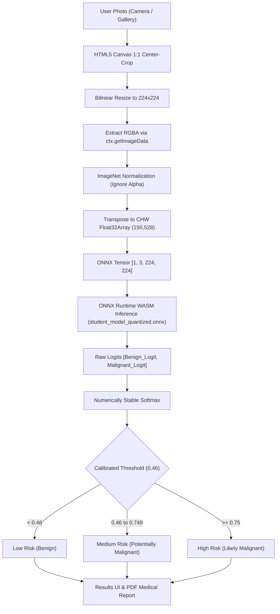

# DermoHelper: Mobile & Web Deployment Guide (ONNX Model Integration)

## 1. Executive Summary

**DermoHelper** is a cross-platform skin cancer screening application built with **React 18**, **TypeScript**, **Vite**, **Tailwind CSS**, and **Capacitor**. It performs real-time, client-side machine learning inference directly on the user's device using **ONNX Runtime Web** (`onnxruntime-web`) via WebAssembly (WASM).

All image preprocessing is executed using a lightweight native **HTML5 `<canvas>`** pipeline, entirely eliminating third-party tensor libraries for data preparation. The application is architected for zero-guesswork, zero-telemetry, and 100% on-device offline execution.



---

## 2. Machine Learning Architecture & Calibration

### 2.1 Model Specifications
* **Model File**: `public/models/student_model_quantized.onnx`
* **Architecture**: MobileNet / EfficientNet distilled student classifier, 8-bit integer quantized (INT8)
* **Execution Engine**: `onnxruntime-web` WebAssembly backend (`wasm` execution provider)
* **WASM Runtime Config**:
  ```typescript
  ort.env.wasm.numThreads = 1; // Single-threaded for universal mobile browser support
  ort.env.wasm.simd = true;        // SIMD acceleration enabled
  ```
* **Input Tensor Specification**:
  * Name: `'input'`
  * Shape: `[1, 3, 224, 224]` (Batch size = 1, Channels = 3 (RGB), Height = 224, Width = 224)
  * Data Type: `Float32`
  * Memory Layout: **CHW / NCHW** (Channel, Height, Width)
* **Output Tensor Specification**:
  * Name: `'output'`
  * Shape: `[1, 2]`
  * Values: `[Benign_Logit, Malignant_Logit]`
  * Data Type: `Float32`

---

### 2.2 HTML5 Canvas Image Preprocessing Pipeline

To ensure the client inference input matches the model's training distribution precisely, the pipeline performs five mathematical steps in [src/services/modelService.ts](file:///d:/AllLearnings/MAG-KD_Argon/dermo-helper-app/src/services/modelService.ts):

1. **Aspect Ratio Center-Crop**:
   The input image's shortest dimension is calculated:
   $$\text{side} = \min(\text{width}, \text{height})$$
   The center crop coordinates are determined:
   $$s_x = \frac{\text{width} - \text{side}}{2}, \quad s_y = \frac{\text{height} - \text{side}}{2}$$

2. **Resize to 224 × 224**:
   The cropped square area is drawn onto an offscreen HTML5 `<canvas>` element with dimensions set exactly to $224 \times 224$:
   ```typescript
   ctx.drawImage(imgElement, sx, sy, side, side, 0, 0, 224, 224);
   ```

3. **Pixel Extraction**:
   Pixel byte data is extracted using `ctx.getImageData(0, 0, 224, 224).data`, returning a `Uint8ClampedArray` containing $224 \times 224 \times 4 = 200,704$ bytes (RGBA format).

4. **ImageNet Normalization**:
   The R, G, and B color channels are normalized using canonical ImageNet mean ($\mu$) and standard deviation ($\sigma$). The Alpha channel at index $4i + 3$ is discarded:
   $$\mu_R = 0.485, \quad \mu_G = 0.456, \quad \mu_B = 0.406$$
   $$\sigma_R = 0.229, \quad \sigma_G = 0.224, \quad \sigma_B = 0.225$$
   $$\text{norm}(v, \mu, \sigma) = \frac{\frac{v}{255.0} - \mu}{\sigma}$$

5. **Channel Transposition to CHW**:
   The data is flattened into a single contiguous `Float32Array` of size **150,528** ($3 \times 224 \times 224$), sequentially storing all Red values first, all Green values second, and all Blue values third:
   * **Red channel**: indices `0` through `50,175`
   * **Green channel**: indices `50,176` through `100,351`
   * **Blue channel**: indices `100,352` through `150,527`

```typescript
export function preprocessImageCanvas(imgElement: HTMLImageElement): Float32Array {
  const canvas = document.createElement('canvas');
  canvas.width = 224;
  canvas.height = 224;

  const ctx = canvas.getContext('2d', { willReadFrequently: true });
  if (!ctx) throw new Error('Failed to obtain 2D rendering context.');

  const srcWidth = imgElement.naturalWidth || imgElement.width;
  const srcHeight = imgElement.naturalHeight || imgElement.height;
  const side = Math.min(srcWidth, srcHeight);
  const sx = (srcWidth - side) / 2;
  const sy = (srcHeight - side) / 2;

  ctx.drawImage(imgElement, sx, sy, side, side, 0, 0, 224, 224);

  const rgba = ctx.getImageData(0, 0, 224, 224).data;
  const numPixels = 224 * 224; // 50,176
  const preprocessedData = new Float32Array(3 * numPixels); // 150,528

  const meanR = 0.485, meanG = 0.456, meanB = 0.406;
  const stdR = 0.229,  stdG = 0.224,  stdB = 0.225;

  for (let i = 0; i < numPixels; i++) {
    const r = rgba[i * 4];
    const g = rgba[i * 4 + 1];
    const b = rgba[i * 4 + 2];

    preprocessedData[i] = (r / 255.0 - meanR) / stdR;
    preprocessedData[numPixels + i] = (g / 255.0 - meanG) / stdG;
    preprocessedData[2 * numPixels + i] = (b / 255.0 - meanB) / stdB;
  }

  return preprocessedData;
}
```

---

### 2.3 Numerically Stable Softmax

Direct exponentiation of raw neural network logits can overflow to $\infty$ or underflow to $0$ in floating-point arithmetic. To prevent numerical instability, logits are shifted by their maximum value:

$$M = \max(z_0, z_1)$$
$$P(\text{Benign}) = \frac{\exp(z_0 - M)}{\exp(z_0 - M) + \exp(z_1 - M)}$$
$$P(\text{Malignant}) = \frac{\exp(z_1 - M)}{\exp(z_0 - M) + \exp(z_1 - M)}$$

```typescript
const maxLogit = Math.max(outputData[0], outputData[1]);
const exp0 = Math.exp(outputData[0] - maxLogit);
const exp1 = Math.exp(outputData[1] - maxLogit);
const sum = exp0 + exp1;

const benignProb = exp0 / sum;
const malignantProb = exp1 / sum;
```

---

### 2.4 Calibrated Clinical Threshold (0.46) & Risk Tiers

> [!IMPORTANT]
> The classification decision boundary uses a strictly calibrated threshold of **0.46 (46.0%)**, derived from test set validation curves to optimize sensitivity for cancer detection. Do not revert this to 0.50.

| Malignancy Probability ($P$) | Risk Tier Classification | Clinical Interpretation | UI Color Theme | Status Icon |
| :--- | :--- | :--- | :--- | :--- |
| **$P < 0.46$** | **Low Risk (Benign)** | Lesion features strongly favor benign pathology. Routine self-monitoring advised. | Emerald Green (`#059669`) | `ShieldCheck` |
| **$0.46 \le P < 0.75$** | **Medium Risk (Potentially Malignant)** | Borderline / atypical features detected above the clinical safety cutoff. Dermatological consult recommended. | Amber Orange (`#D97706`) | `AlertTriangle` |
| **$P \ge 0.75$** | **High Risk (Likely Malignant)** | High confidence of malignant characteristics. Prompt specialist clinical evaluation strongly advised. | Crimson Red (`#DC2626`) | `ShieldAlert` |

---

## 3. Offline Architecture & UI System

### 3.1 Offline Readiness Indicator (`OfflineReadyBadge`)
Located in [src/components/OfflineReadyBadge.tsx](file:///d:/AllLearnings\MAG-KD_Argon\dermo-helper-app\src\components\OfflineReadyBadge.tsx):

* **Design**: Rounded pill container (`rounded-full`) matching the clean light aesthetic.
* **Elements**:
  * Live pulsing emerald dot: `<span className="relative inline-flex rounded-full h-2 w-2 bg-emerald-500 ...">`
  * Crossed-out Wi-Fi icon: `<WifiOff className="w-3.5 h-3.5 text-emerald-600" />`
  * Text label: **`ONNX WASM Ready · 100% Offline`**
* **Readiness Guard**: Utilizes `useModelReady` hook in [src/hooks/useModelReady.ts](file:///d:/AllLearnings\MAG-KD_Argon\dermo-helper-app\src\hooks\useModelReady.ts). The badge renders **`null`** until the ONNX model is verified in WebAssembly memory (`this.session !== null`).
* **Placement**:
  * **Home Screen ([src/pages/Index.tsx](file:///d:/AllLearnings\MAG-KD_Argon\dermo-helper-app\src\pages\Index.tsx))**: Positioned between the hero description and the primary action buttons.
  * **Global Header ([src/components/Header.tsx](file:///d:/AllLearnings\MAG-KD_Argon\dermo-helper-app\src\components\Header.tsx))**: Displayed in the top-right app bar across all navigation views.

### 3.2 Segmented Confidence Progress Bar
Located in [src/pages/Results.tsx](file:///d:/AllLearnings\MAG-KD_Argon\dermo-helper-app\src\pages\Results.tsx):

* **Visual Track**: Light-themed track (`bg-slate-100`) with smooth rounded geometry.
* **Clinical Dividers**: Vertical guideline ticks positioned at **46%** (clinical decision threshold) and **75%** (high-risk boundary).
* **Axis Labels**:
  * Left: `0% (Benign)`
  * Center Left: `▲ 46% Cutoff`
  * Center Right: `▲ 75% High Risk`
  * Right: `100%`
* **Dynamic Risk Fill**: Color dynamically updates to Emerald Green ($< 0.46$), Amber Orange ($0.46 - 0.75$), or Crimson Red ($\ge 0.75$).

---

## 4. Project Directory Structure

```
dermo-helper-app/
├── public/
│   └── models/
│       └── student_model_quantized.onnx    # 8-bit quantized ONNX model
├── src/
│   ├── components/
│   │   ├── ActionButton.tsx               # Primary/secondary UI action buttons
│   │   ├── Header.tsx                     # Sticky app bar with offline status badge
│   │   ├── ImagePreview.tsx               # Responsive lesion preview container
│   │   ├── Layout.tsx                     # Root page layout wrapper
│   │   ├── OfflineReadyBadge.tsx          # "ONNX WASM Ready · 100% Offline" pill
│   │   ├── SkinLesionDetector.tsx         # Standalone test detector component
│   │   └── ui/                            # Lean UI components (Button, Card, Sonner, Toast)
│   ├── hooks/
│   │   ├── use-toast.ts                   # Toast notification hook
│   │   ├── useCapacitorCamera.tsx         # Native hardware camera bridge
│   │   └── useModelReady.ts               # Reactive ONNX WASM readiness listener
│   ├── pages/
│   │   ├── Index.tsx                      # Home screen (Hero, Photo, Gallery)
│   │   ├── Camera.tsx                     # Real-time photo capture screen
│   │   └── Results.tsx                    # Detailed diagnostic evaluation & report
│   ├── services/
│   │   └── modelService.ts                # Singleton ONNX inference & canvas preprocessor
│   ├── App.tsx                            # Route definitions
│   ├── index.css                          # Tailwind CSS custom styles & animations
│   └── main.tsx                           # Application entry point
├── android/                               # Native Android project (Capacitor)
├── capacitor.config.json                  # Capacitor native runtime configuration
├── package.json                           # Cleaned, optimized dependency manifest
├── tailwind.config.ts                     # Tailwind theme and custom keyframes
└── vite.config.ts                         # Vite build and asset pipeline configuration
```

---

## 5. Development & Verification Guide

### 5.1 Local Web Development
Launch the local Vite development server:
```bash
npm run dev
```
Navigate to `http://localhost:8080` in your web browser.

### 5.2 Browser Console Verification
Open Developer Tools (`F12` or `Ctrl + Shift + I`) and view the **Console** tab during a scan:
```text
[ModelService] Attempting to load ONNX model from: /models/student_model_quantized.onnx
[ModelService] Successfully loaded student_model_quantized.onnx from: /models/student_model_quantized.onnx
[ModelService] Model inputs: ['input']
[ModelService] Model outputs: ['output']
[ModelService] Evaluated with student_model_quantized.onnx. Raw logits: [-0.1582, 0.3145]
[ModelService] Inference completed in 68ms: Malignant (61.6% Malignant, 38.4% Benign)
```

### 5.3 Production Web Build
```bash
npm run build
```
Generates an optimized static bundle in the `dist/` folder:
* **HTML & CSS**: Minified and purged via Tailwind CSS.
* **JavaScript**: Code-split, tree-shaken ES modules (~2.8 MB total with full ONNX Runtime).
* **WASM Assets**: `ort-wasm-simd-threaded.jsep.wasm` bundled for browser caching.

---

## 6. Native Mobile Deployment (Capacitor Android)

### 6.1 Prerequisites
* **Node.js**: v18.0.0 or higher
* **Java Development Kit (JDK)**: JDK 17 or higher
* **Android Studio**: Ladybug / Hedgehog or newer with Android SDK Platform 34+

### 6.2 Step-by-Step Build & Sync Workflow

1. **Build Production Web Assets**:
   ```bash
   npm run build
   ```

2. **Sync Assets to Native Android Container**:
   ```bash
   npx cap sync android
   ```

3. **Open Project in Android Studio**:
   ```bash
   npx cap open android
   ```

4. **Verify Android Permissions**:
   Confirm the following entries are present in `android/app/src/main/AndroidManifest.xml`:
   ```xml
   <uses-permission android:name="android.permission.CAMERA" />
   <uses-permission android:name="android.permission.READ_EXTERNAL_STORAGE" />
   <uses-permission android:name="android.permission.WRITE_EXTERNAL_STORAGE" />
   <uses-feature android:name="android.hardware.camera" android:required="false" />
   ```

5. **Run on Device / Emulator**:
   * Connect an Android device via USB with **USB Debugging** enabled.
   * In Android Studio, select the target device and click **Run** (`Shift + F10`).
   * The app will execute inference entirely on-device hardware with Airplane Mode enabled.

---

## 7. Troubleshooting & FAQ

| Issue / Error | Root Cause | Verified Solution |
| :--- | :--- | :--- |
| `npm error 404 @tensorflow/tfjs-backend-onnx` | Package does not exist in npm registry. | Use `onnxruntime-web` directly. All models are executed using the native WASM engine. |
| `Failed to load student_model_quantized.onnx` | Model file missing or path resolution issue in Capacitor webview. | Ensure `student_model_quantized.onnx` resides in `public/models/`. `modelService.ts` automatically attempts relative and absolute path variants. |
| Camera fails to open on Desktop | Desktop browser lacks camera hardware or permission. | Use the **Upload from Gallery** button to select images (`.jpg`, `.png`, `.webp`) from local disk. |
| Black or inverted inference results | Incorrect tensor channel order or Alpha inclusion. | `preprocessImageCanvas` explicitly loops $R \rightarrow G \rightarrow B$, ignores Alpha, and normalizes with ImageNet statistics. |
| Large JavaScript bundle size warning | Standard when bundling ONNX WASM runtime. | Native Canvas preprocessing has already removed 1.6 MB of bundle size. ONNX runtime WebAssembly binaries are cached after first load. |
